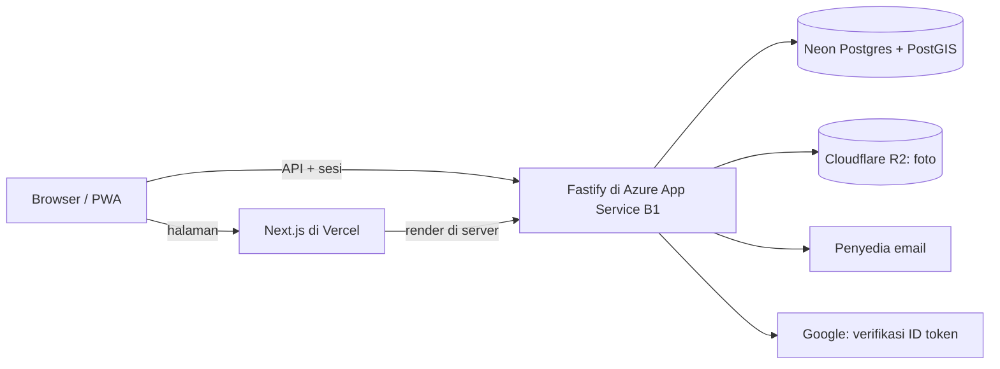

# ADR-0013: Tech Stack Next.js + Fastify, Neon, Azure, dan Cloudflare R2

- Status: Accepted
- Tanggal: 2026-10-21
- Pengambil keputusan: Tim AksesBogor
- Issue: #18
- Di-supersede sebagian oleh: [ADR-0025](0025-api-dan-postgresql-di-vps-sendiri.md) (hosting API dan database)

## Konteks dan Masalah

Tech stack produksi masih terbuka ([PT-11](../product/pertanyaan-terbuka.md#pt-11-tech-stack-produksi)), padahal [PRD](../product/prd.md) membutuhkan web mobile-first yang bisa dipasang ([ADR-0012](0012-web-mobile-first-pwa.md)), login ([ADR-0011](0011-pelapor-wajib-login.md)), query geospasial untuk batas Kota Bogor dan laporan ganda ([ADR-0010](0010-cakupan-wilayah-kota-bogor.md), FR-23), unggah foto, notifikasi email, dan panel verifikator. Guideline repositori juga mewajibkan API spec dan diagram arsitektur. Tim sudah menjalankan pola Next.js + Fastify di proyek lokerin.

## Decision Drivers

- Tim sudah berpengalaman dengan stack yang sama (lokerin).
- Satu bahasa (TypeScript) dari web sampai API.
- Dukungan geospasial yang matang.
- Biaya rendah untuk proyek kampus.
- Data pribadi tetap di bawah kendali tim (UU No. 27 Tahun 2022).
- API spec bisa dibuat otomatis dari kode.

## Opsi yang Dipertimbangkan

1. Next.js + Fastify (TypeScript), Postgres + PostGIS
2. Laravel + Inertia (React) + Filament, Postgres + PostGIS
3. Next.js + Supabase (Postgres, Auth, Storage)
4. React + Firebase (Firestore, Auth, Storage, Functions)

## Keputusan

Opsi terpilih: "Next.js + Fastify", mengikuti pola lokerin.

| Lapisan | Pilihan |
| --- | --- |
| Web | Next.js (App Router), React, TypeScript, Tailwind CSS v4 di Vercel. Token design system dipakai sebagai CSS variables dengan nama yang sama seperti code syntax di Figma (`var(--color-…)`). |
| API | Fastify (TypeScript) dengan skema JSON di setiap route. OpenAPI dibuat otomatis dari skema itu dan menjadi API spec repo. |
| Hosting API | Azure App Service Linux B1, region Southeast Asia, Always On, sebagai aplikasi sendiri yang terpisah dari lokerin. Deploy langsung sebagai aplikasi Node karena tidak butuh Chromium. |
| Database | Neon Postgres (Singapura) dengan PostGIS, diakses lewat Drizzle ORM. |
| Foto | Cloudflare R2. Fastify memperkecil foto dan menghapus metadata EXIF sebelum mengunggah. |
| Email | Penyedia email transaksional, dipilih saat implementasi. |
| Peta | Mengikuti [ADR-0008](0008-peta-leaflet-dan-openstreetmap.md), yang masih Proposed. |
| Repo | [`akses-bogor-web`](https://github.com/al-dioooo/akses-bogor-web) dan [`akses-bogor-api`](https://github.com/al-dioooo/akses-bogor-api), mengikuti guideline repositori tim. |

Browser tidak pernah terhubung langsung ke database atau R2. Fastify memeriksa sesi dan peran di setiap request.

## Konsekuensi

- Positif: pola, konvensi, dan sebagian kode lokerin bisa dipakai ulang; tim tidak belajar stack baru.
- Positif: TypeScript di web dan API memungkinkan tipe data dibagi bersama.
- Positif: API spec OpenAPI selalu sesuai dengan kode.
- Positif: PostGIS menangani cek batas Kota Bogor dan pencarian lokasi terdekat.
- Negatif: panel verifikator (FR-30 sampai FR-36) dibangun sendiri di Next.js, tanpa generator panel admin.
- Negatif: ada dua layanan yang dideploy terpisah, sehingga perlu CORS dan pengaturan cookie sesi per origin seperti di lokerin.
- Negatif: B1 kira-kira US$13 per bulan (perkiraan di ADR 0007 lokerin). Bila memakai langganan Azure for Students yang sama dengan lokerin, kreditnya habis lebih cepat, jadi pasang budget alert.
- Negatif: server selalu menyala walaupun AksesBogor tidak butuh koneksi panjang. Biaya ini diterima demi konsistensi dengan lokerin.
- Netral: paket Hobby Vercel hanya membangun commit pemilik proyek; lokerin sudah punya workflow untuk mengatasinya.

## Pro & Kontra tiap Opsi

### Next.js + Fastify

- Pro: sudah dikuasai tim; satu bahasa; API spec otomatis; kontrol penuh atas data.
- Kontra: panel verifikator dan auth dibangun sendiri; dua deploy.

### Laravel + Inertia + Filament

- Pro: panel verifikator sebagian besar dari Filament; auth, queue, dan mail bawaan.
- Kontra: tim lebih berpengalaman dengan TypeScript; dua bahasa di proyek.

### Next.js + Supabase

- Pro: auth, storage, dan PostGIS siap pakai; mulai paling cepat.
- Kontra: proyek gratis dijeda saat tidak aktif; produksi butuh paket berbayar; aturan row-level security harus tepat.

### React + Firebase

- Pro: auth matang dan hosting sederhana.
- Kontra: filter gabungan dan pencarian lokasi terdekat canggung di Firestore; Functions butuh paket bayar per pakai.

## Referensi

- [Pertanyaan Terbuka PT-11](../product/pertanyaan-terbuka.md#pt-11-tech-stack-produksi)
- [PRD](../product/prd.md)
- [ADR-0014](0014-login-google-dan-kode-email.md)
- Repo lokerin: `al-dioooo/lokerin-docs` (ADR 0007) dan `al-dioooo/lokerin-web`
