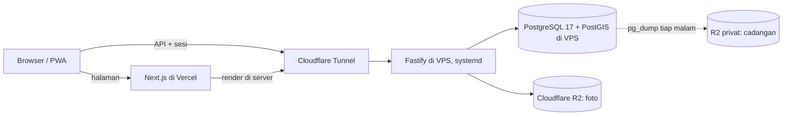

# ADR-0025: API dan PostgreSQL Berjalan di VPS Milik Tim

- Status: Accepted
- Tanggal: 2026-10-26
- Pengambil keputusan: Tim AksesBogor
- Issue: #39
- Men-supersede sebagian: [ADR-0013](0013-tech-stack-nextjs-fastify.md) (hosting API dan database)
- Di-supersede sebagian oleh: [ADR-0026](0026-api-dan-postgresql-di-evergarden-oci.md) (server produksi, versi PostgreSQL dan Node, dan cara deploy)

## Konteks dan Masalah

[ADR-0013](0013-tech-stack-nextjs-fastify.md) menaruh API Fastify di Azure App Service Linux B1 dan database di Neon Postgres. Tim memutuskan tidak memakai keduanya. Tim sudah punya VPS sendiri di Indonesia (YoRHa Garden) yang menjalankan Cloudflare Tunnel. Di mana API dan database berjalan, bagaimana API dibuka ke internet, dan bagaimana data dicadangkan?

## Decision Drivers

- Tidak ada tagihan bulanan untuk hosting API dan database, dan tidak bergantung pada kredit Azure for Students.
- Data pribadi disimpan di server yang dikendalikan tim (UU No. 27 Tahun 2022).
- PostGIS dan `pg_trgm` harus tersedia untuk cek wilayah dan pencarian nama lokasi.
- VPS tidak punya IP publik, jadi akses dari luar harus lewat tunnel.
- Data tidak boleh hilang bila VPS rusak.

## Opsi yang Dipertimbangkan

1. systemd + PostgreSQL dari paket Debian, dibuka lewat Cloudflare Tunnel
2. Docker Compose (API dan image `postgis/postgis`), dibuka lewat Cloudflare Tunnel
3. PM2 + Caddy dengan sertifikat Let's Encrypt
4. Tetap di Azure App Service B1 dan Neon

## Keputusan

Opsi terpilih: "systemd + PostgreSQL dari paket Debian, dibuka lewat Cloudflare Tunnel", karena bagiannya paling sedikit dan tunnel-nya sudah berjalan di VPS.

| Lapisan | Pilihan |
| --- | --- |
| Server | VPS milik tim (YoRHa Garden), dikelola sendiri, di Indonesia. Debian 13. |
| API | Fastify berjalan sebagai service systemd (`node dist/server.js`) dengan user sistem sendiri dan hanya mendengar di `127.0.0.1`. Port diatur lewat `PORT`; port bawaan `8080` sudah dipakai layanan lain di VPS, jadi produksi memakai port lain. systemd menyalakan ulang proses yang mati. |
| Akses dari luar | Cloudflare Tunnel meneruskan hostname API ke port lokal itu. TLS diurus Cloudflare, dan VPS tidak membuka port ke internet. |
| Database | PostgreSQL 17 dengan PostGIS 3 dan `pg_trgm` dari paket Debian, hanya menerima koneksi dari localhost. Aplikasi dan migrasi memakai satu `DATABASE_URL`. |
| Cadangan | Timer systemd menjalankan `pg_dump -Fc` setiap malam. Tujuh dump terakhir disimpan di VPS, dan setiap dump disalin ke bucket R2 privat yang terpisah dari bucket foto, disimpan 30 hari. |
| Tidak berubah | Web Next.js di Vercel, foto di Cloudflare R2, dan bagian lain [ADR-0013](0013-tech-stack-nextjs-fastify.md). |

## Konsekuensi

- Positif: hosting API dan database tidak lagi memakan biaya bulanan atau kredit Azure.
- Positif: database tidak tertidur saat sepi seperti compute Neon, jadi request pertama tidak menunggu database bangun.
- Positif: semua trafik API masuk lewat Cloudflare; VPS tidak membuka port.
- Negatif: tim sendiri yang mengurus pembaruan keamanan Debian dan PostgreSQL, pemantauan, dan ruang disk. Disk VPS dipakai bersama layanan lain, jadi ukuran database dan dump lokal perlu dipantau.
- Negatif: hanya satu server. Bila VPS mati, listrik padam, atau internetnya putus, API ikut mati sampai VPS pulih, dan data sejak dump terakhir (paling lama satu hari) bisa hilang.
- Negatif: cadangan baru berguna bila pemulihannya pernah dicoba. Uji pemulihan dari dump R2 dijalankan sebelum beta.
- Netral: data akun yang dihapus masih ada di cadangan sampai 30 hari. Angka ini yang dicantumkan di Kebijakan Privasi ([ADR-0024](0024-data-setelah-akun-dihapus.md)).
- Netral: deploy ke VPS belum otomatis; workflow deploy dibuat terpisah. Tes tetap memakai PGlite di dalam proses, jadi CI tidak butuh PostgreSQL.

## Pro & Kontra tiap Opsi

### systemd + PostgreSQL dari paket Debian + Cloudflare Tunnel

- Pro: paling sederhana; pembaruan keamanan datang lewat apt; memakai tunnel yang sudah ada; tidak membuka port.
- Kontra: versi Node dan PostgreSQL mengikuti mesin, bukan berkas di repo; pengaturan server dicatat di dokumen, bukan di kode.

### Docker Compose + Cloudflare Tunnel

- Pro: lingkungan bisa dibuat ulang dari berkas di repo; versi PostGIS dikunci di image.
- Kontra: lapisan tambahan untuk tim kecil; volume data dan pembaruan image diurus sendiri; user deploy belum punya akses Docker.

### PM2 + Caddy (Let's Encrypt)

- Pro: pola yang umum; Caddy mengurus sertifikat sendiri.
- Kontra: butuh IP publik atau port forwarding 80/443 ke VPS, dan keduanya belum ada.

### Tetap di Azure App Service B1 dan Neon

- Pro: server dan database dikelola penyedia; Neon punya branch database untuk pengembangan.
- Kontra: sekitar US$13 per bulan untuk B1 dari kredit Azure for Students; compute Neon tertidur saat sepi sehingga pool harus siap menerima koneksi yang diputus.

## Referensi

- [ADR-0013](0013-tech-stack-nextjs-fastify.md) (di-supersede sebagian)
- [ADR-0024](0024-data-setelah-akun-dihapus.md) (masa simpan cadangan)
- Issue #39
