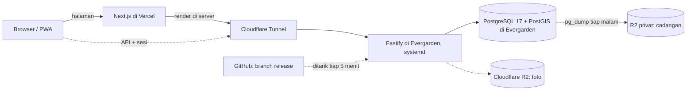

# ADR-0026: API dan PostgreSQL Produksi Pindah ke Evergarden (OCI Batam)

- Status: Accepted
- Tanggal: 2026-10-31
- Pengambil keputusan: Tim AksesBogor
- Issue: #41
- Men-supersede sebagian: [ADR-0025](0025-api-dan-postgresql-di-vps-sendiri.md) (server produksi, versi PostgreSQL dan Node, dan cara deploy)

## Konteks dan Masalah

[ADR-0025](0025-api-dan-postgresql-di-vps-sendiri.md) menaruh API dan PostgreSQL produksi di YoRHa Garden. Pengembangan sekarang berjalan di Evergarden, VM Oracle Cloud Infrastructure (OCI) yang dikelola tim, dan YoRHa Garden tidak bisa dijangkau dari sana. Akibatnya belum ada API yang bisa dibuka tim. Di mana produksi berjalan, bagaimana deploy-nya, dan data apa yang tampil sebelum data lapangan masuk?

## Decision Drivers

- Tim butuh preview yang bisa dibuka dari browser, dengan data dari API sungguhan.
- Data tetap di Indonesia, di server yang dikelola tim (UU No. 27 Tahun 2022).
- Pendekatan ADR-0025 dipertahankan: systemd, Cloudflare Tunnel tanpa port terbuka, satu `DATABASE_URL`, dan cadangan setiap malam.
- Evergarden dipakai bersama layanan lain: port 5432 dan 8080 sudah terpakai, tunnel-nya juga melayani hostname lain, dan RAM yang tersisa sekitar 3 GB tanpa swap.
- Deploy tidak boleh butuh akses masuk ke server atau secret di GitHub.

## Opsi yang Dipertimbangkan

1. Evergarden: systemd + PostgreSQL 17 dari PGDG, dibuka lewat tunnel yang sudah ada
2. Evergarden: systemd + PostgreSQL 16 dari paket Ubuntu
3. Evergarden: Docker Compose (API dan image `postgis/postgis`)
4. Tetap di YoRHa Garden

## Keputusan

Opsi terpilih: "Evergarden: systemd + PostgreSQL 17 dari PGDG", karena hanya mesin ini yang bisa dijangkau tim sekarang, region-nya di Indonesia, tunnel-nya sudah berjalan, dan versi PostgreSQL-nya sama dengan YoRHa Garden dan PGlite di tes.

| Lapisan | Pilihan |
| --- | --- |
| Server | Evergarden: `VM.Standard.E5.Flex` (x86_64, 8 OCPU, 16 GB) di OCI region Batam (`ap-batam-1`), Ubuntu 24.04. Dipakai bersama layanan lain. |
| API | Service systemd `akses-bogor-api` dengan user sistem `aksesbogor`: `node dist/server.js` di `127.0.0.1:8090`, Node.js 24 LTS dari paket NodeSource yang sudah terpasang. Memori dibatasi 512 MB. systemd menyalakan ulang proses yang mati dan menjalankannya saat boot. |
| Akses dari luar | Hostname `akses-bogor-api.yorhagarden.xyz` ditambahkan ke Cloudflare Tunnel yang sudah ada lewat dashboard Cloudflare. Hostname lain di tunnel itu tidak berubah, dan port API tidak dibuka ke internet. |
| Database | PostgreSQL 17 + PostGIS 3 dari repositori PGDG, cluster sendiri di port 5433 (5432 dipakai container milik layanan lain), hanya menerima koneksi lokal. API masuk lewat Unix socket dengan autentikasi peer, jadi tidak ada password database. Aplikasi dan migrasi memakai satu `DATABASE_URL`. |
| Konfigurasi | `/etc/akses-bogor/api.env`, di luar repo. Contohnya `deploy/api.env.example` di akses-bogor-api. |
| Deploy | Timer systemd memeriksa branch `release` setiap 5 menit. Bila ada commit baru, skrip deploy mengekspor commit itu ke folder rilis baru, menjalankan `pnpm install`, `pnpm build`, dan `pnpm db:migrate`, lalu memindahkan tautan `current` dan me-restart API. Tiga rilis terakhir disimpan untuk rollback. Vercel juga membangun `release` sebagai produksi. |
| Cadangan | Seperti ADR-0025: `pg_dump -Fc` setiap malam pukul 02.30 WIB, tujuh dump di Evergarden, dan salinan di bucket R2 privat selama 30 hari. Dump dibuat oleh user `postgres` dan tidak bisa dibaca user API. |
| Data preview | Sampai data lapangan pertama masuk ([PT-12](../product/pertanyaan-terbuka.md#pt-12-data-awal)), database berisi enam kecamatan dan tujuh lokasi fiktif dari `pnpm db:seed`, yang dijalankan sekali dengan tangan. Data contoh dihapus sebelum data nyata masuk. |
| YoRHa Garden | Bukan lagi produksi. Tetap menjalankan PostgreSQL dan API pengembangan di `127.0.0.1:8090` untuk yang bekerja di sana. |
| Tidak berubah | Web Next.js di Vercel, foto di Cloudflare R2, dan bagian lain [ADR-0013](0013-tech-stack-nextjs-fastify.md) dan ADR-0025. |

## Konsekuensi

- Positif: tim punya API dan preview yang bisa dibuka sekarang, tanpa menunggu YoRHa Garden bisa dijangkau.
- Positif: region Batam ada di Indonesia, jadi data tetap di dalam negeri seperti alasan di ADR-0025.
- Positif: deploy tidak butuh SSH dari luar atau secret di GitHub, karena server yang menarik perubahan. Merge ke `release` berarti rilis, sesuai aturan branch.
- Positif: tidak ada password database yang perlu disimpan atau dirotasi.
- Negatif: perangkat keras dan jaringannya milik Oracle. Tim mengelola VM, sistem operasi, dan database, tetapi Oracle ikut menjadi penyedia infrastruktur yang perlu disebut di Kebijakan Privasi, bersama Cloudflare dan Vercel.
- Negatif: Evergarden dipakai bersama layanan lain dan tidak punya swap. Saat keputusan ini dibuat, sisa RAM sekitar 3 GB dan satu server pengembangan lain memakai lebih dari 5 GB. Bila memori habis, kernel bisa mematikan PostgreSQL atau API. Batas memori API membantu, tetapi pemakaian memori perlu dipantau.
- Negatif: rilis baru tayang paling lama 5 menit setelah `release` berubah, dan hasilnya hanya terlihat di journal (`journalctl -u akses-bogor-deploy`). Belum ada notifikasi bila deploy gagal.
- Negatif: masih satu server. Risiko di ADR-0025 soal server mati dan data sejak dump terakhir tetap berlaku.
- Netral: Node di produksi versi 24, sedangkan `.nvmrc` dan CI masih 22. `engines` mengizinkan keduanya, tetapi CI perlu disamakan.
- Netral: `pnpm db:seed` menolak berjalan di production. Seed preview dijalankan sekali dengan `NODE_ENV=development` secara sengaja, dan tidak boleh diulang setelah ada data nyata karena seed mengosongkan data lokasi dan laporan.
- Netral: dump dari Evergarden bisa dipulihkan di YoRHa Garden dan sebaliknya, karena keduanya PostgreSQL 17.

## Pro & Kontra tiap Opsi

### Evergarden: systemd + PostgreSQL 17 dari PGDG

- Pro: sama dengan ADR-0025, jadi langkah pemulihan di README tetap berlaku; versinya sama dengan YoRHa Garden dan PGlite di tes; memakai tunnel yang sudah berjalan.
- Kontra: menambah repositori apt PGDG, yang perlu ikut dipercaya untuk pembaruan keamanan.

### Evergarden: systemd + PostgreSQL 16 dari paket Ubuntu

- Pro: tidak ada repositori tambahan; pembaruan datang dari Ubuntu.
- Kontra: PostGIS ada di `universe`; dump dari PostgreSQL 17 di YoRHa Garden tidak bisa dipulihkan ke 16; berbeda dengan README dan PGlite di tes.

### Evergarden: Docker Compose

- Pro: lingkungan bisa dibuat ulang dari berkas di repo.
- Kontra: user deploy tidak punya akses Docker; port 5432 tetap bentrok dengan container lain; volume data dan pembaruan image diurus sendiri.

### Tetap di YoRHa Garden

- Pro: server khusus tim dan tidak perlu ADR baru.
- Kontra: tidak bisa dijangkau dari mesin tempat pengembangan sekarang berjalan, jadi preview belum bisa dibuat.

### Cara deploy

- Timer yang menarik `release` (dipilih): tidak butuh akses masuk atau secret, dengan jeda paling lama 5 menit.
- `deploy.sh` manual saja: paling sederhana, tetapi rilis menunggu orang yang punya akses SSH.
- GitHub Actions lewat SSH: hasil deploy terlihat di GitHub, tetapi butuh kunci SSH di secret GitHub dan port 22 yang terbuka untuk runner GitHub.

## Referensi

- [ADR-0025](0025-api-dan-postgresql-di-vps-sendiri.md) (di-supersede sebagian)
- [ADR-0013](0013-tech-stack-nextjs-fastify.md)
- [ADR-0024](0024-data-setelah-akun-dihapus.md) (masa simpan cadangan)
- Issue #41; berkas deploy di [akses-bogor-api](https://github.com/al-dioooo/akses-bogor-api) folder `deploy/`
