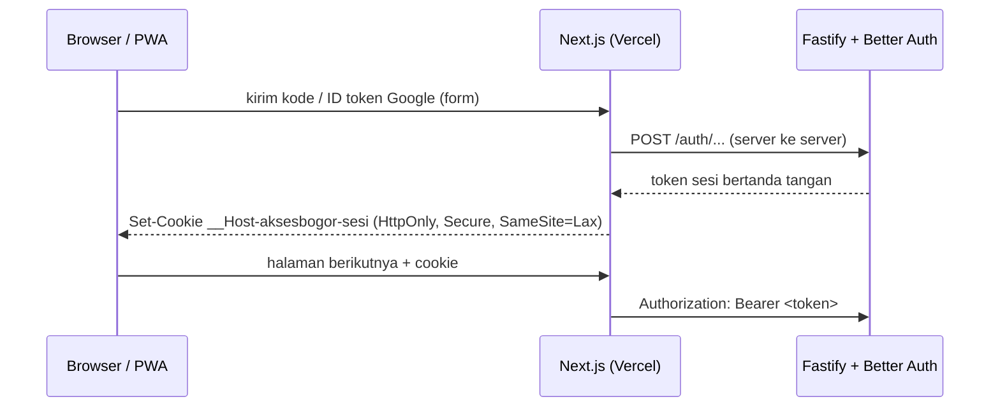

# ADR-0029: Akun dengan Better Auth di API, Sesi Disimpan Server Web

- Status: Accepted
- Tanggal: 2026-11-07
- Pengambil keputusan: Tim AksesBogor
- Issue: #50

## Konteks dan Masalah

[ADR-0014](0014-login-google-dan-kode-email.md) menetapkan metode login: Google Identity Services atau kode 6 digit lewat email, dengan sesi berupa token bertanda tangan dan nilai awal untuk kode. [ADR-0013](0013-tech-stack-nextjs-fastify.md) mencatat bahwa web (Vercel) dan API (Evergarden, [ADR-0026](0026-api-dan-postgresql-di-evergarden-oci.md)) berada di domain berbeda, sehingga cookie sesi perlu diatur. Yang belum diputuskan: library auth, tempat cookie sesi, batas permintaan kode, umur sesi, dan kapan akun dibuat.

## Decision Drivers

- Proses masuk aksesibel dan tanpa tes kognitif (WCAG 2.2 kriteria 3.3.8, [ADR-0011](0011-pelapor-wajib-login.md)).
- Sesi bisa dicabut: saat keluar dan saat akun dihapus ([ADR-0024](0024-data-setelah-akun-dihapus.md)).
- Browser tidak pernah memanggil API langsung (aturan repo web sejak awal).
- Cookie tetap terkirim di Safari dan Chrome yang memblokir cookie pihak ketiga.
- Data pribadi minimal (UU No. 27 Tahun 2022).
- Kode keamanan yang ditulis sendiri sesedikit mungkin.

## Opsi yang Dipertimbangkan

1. Better Auth di API
2. Dibangun sendiri di Fastify, dengan `jose` untuk token Google
3. Dibangun sendiri di Fastify, hanya dengan `node:crypto`

## Keputusan

Opsi terpilih: "Better Auth di API". Library ini sudah menangani kode email, verifikasi ID token Google, sesi di database, dan penggabungan akun, sehingga tim tidak menulis sendiri pemeriksaan tanda tangan dan masa berlaku token.

### Library dan route

- Better Auth 1.7 berjalan di akses-bogor-api dengan adapter Drizzle ke PostgreSQL yang sama. Plugin yang dipakai: `emailOTP` (kode 6 digit) dan `bearer` (token di header `Authorization`). Google memakai `socialProviders.google` dengan ID token dari tombol Google Identity Services, jadi hanya butuh client ID. Client secret Google tidak dipakai.
- Route bawaan Better Auth tidak dibuka. API punya route sendiri di `/auth/*` dan `/me/*` yang memanggil `auth.api.*` dari server. Dengan begitu setiap route tetap punya skema Zod dan masuk ke OpenAPI, galat tetap berbentuk `{ galat, pesan }` dalam bahasa Indonesia, dan rate limit memakai `@fastify/rate-limit` yang sama dengan route lain. Rate limiter bawaan Better Auth dimatikan.
- Telemetri Better Auth dimatikan secara eksplisit.

### Tabel

- `users` yang sudah ada dipakai sebagai tabel pengguna Better Auth, ditambah kolom `email_verified`, `image` (selalu kosong; foto profil Google tidak disimpan), dan `privacy_policy_version`.
- Tabel baru: `sessions`, `accounts` (tautan ke Google), dan `verifications` (kode email). Baris `accounts` tidak menyimpan ID token atau access token Google. Alamat IP dan user agent tidak disimpan di sesi.

### Sesi dan cookie

- Browser hanya berbicara dengan Next.js. Server Next.js menyimpan token sesi di cookie `__Host-aksesbogor-sesi` milik domain web: `HttpOnly`, `Secure`, `SameSite=Lax`, `Path=/`, tanpa atribut `Domain`. Saat memanggil API, server Next.js mengirim token itu sebagai `Authorization: Bearer`.
- Token berbentuk `token.tanda-tangan`, ditandatangani HMAC dengan `BETTER_AUTH_SECRET`. API menolak token tanpa tanda tangan, jadi salinan tabel `sessions` saja tidak cukup untuk masuk sebagai pengguna.
- Sesi berlaku 30 hari sejak terakhir dipakai (diperpanjang paling sering sekali sehari) dan paling lama 90 hari sejak masuk. Setelah itu pengguna masuk lagi. Keluar mencabut sesi itu; menghapus akun mencabut semua sesi.
- Pemeriksaan CSRF: cookie `SameSite=Lax` tidak terkirim pada POST lintas situs, dan Server Action Next.js memeriksa `Origin`.

### Kode email

- 6 digit, berlaku 10 menit, sekali pakai, dan gugur setelah 5 kali salah ([ADR-0014](0014-login-google-dan-kode-email.md)). Meminta kode baru membatalkan kode lama.
- Disimpan sebagai HMAC-SHA-256 dengan `BETTER_AUTH_SECRET`, bukan SHA-256 biasa, karena kode 6 digit mudah ditebak dari hash tanpa kunci.
- Kode baru untuk email yang sama baru bisa diminta 60 detik setelah kode sebelumnya, paling banyak 5 kode per email per jam.
- Per klien: paling banyak 10 permintaan kode dan 30 percobaan kode per 15 menit, serta 30 percobaan masuk Google per 15 menit. Klien dikenali dengan kunci rate limit API yang sama dengan route lain, jadi setelah server web mengirim IP pengunjung, batas ini dihitung per pengunjung, bukan per IP Vercel.
- Batas waktu 10 menit tidak menekan pengguna: layar kode menyebut masa berlakunya, dan "Kirim ulang" selalu tersedia setelah 60 detik tanpa menghapus isian lain (WCAG 2.2 kriteria 2.2.1).

### Akun

- Akun dibuat saat login pertama berhasil, dengan email sebagai identitas. Login Google dengan email terverifikasi dan kode email untuk alamat yang sama masuk ke akun yang sama. Google hanya diterima bila `email_verified` bernilai benar.
- Sampai pengguna mengisi Lengkapi Akun (nama tampilan dan persetujuan Kebijakan Privasi, FR-11), akun hanya bisa membaca profilnya, melengkapi akun, keluar, dan menghapus akun. Waktu persetujuan dan versi Kebijakan Privasi yang disetujui disimpan.
- Akun yang tidak dilengkapi dalam 24 jam dihapus otomatis, bersama sesinya. API juga membersihkan sesi dan kode kedaluwarsa setiap jam.
- Nama tampilan 1 sampai 60 karakter dan bisa diubah di Akun Saya. Email tidak bisa diubah di MVP; pengguna yang ganti email membuat akun baru.

### Pengembangan lokal

Tanpa `GOOGLE_CLIENT_ID`, tombol Google tidak tampil dan route Google menjawab 503. Kode email di luar production dicetak ke log API ([ADR-0030](0030-email-transaksional-resend.md)).

### Konfigurasi

| Variabel | Tempat | Rahasia | Isi |
| --- | --- | --- | --- |
| `BETTER_AUTH_SECRET` | API | Ya | Minimal 32 karakter acak, untuk tanda tangan token dan hash kode |
| `BETTER_AUTH_URL` | API | Tidak | Alamat publik API |
| `GOOGLE_CLIENT_ID` | API | Tidak | Client ID OAuth Google AksesBogor |
| `NEXT_PUBLIC_GOOGLE_CLIENT_ID` | Web | Tidak | Client ID yang sama, untuk tombol Google |

Client OAuth Google dibuat di Google Cloud Console dengan tipe "Web application" dan origin JavaScript berisi alamat web produksi dan `http://localhost:3000`.

## Konsekuensi

- Positif: verifikasi token Google, kode sekali pakai, sesi, dan penggabungan akun memakai kode yang sudah diuji banyak proyek.
- Positif: cookie hanya milik domain web, jadi tidak terkena blokir cookie pihak ketiga dan tetap jalan di preview Vercel tanpa mengubah CORS.
- Positif: Laporkan dan panel verifikator cukup memeriksa sesi lewat satu fungsi di API.
- Negatif: dependensi runtime baru yang cukup besar (Better Auth beserta `jose`, `kysely`, dan lainnya). Pembaruan versinya perlu dibaca catatan rilisnya karena menyentuh keamanan.
- Negatif: struktur tabel mengikuti Better Auth. Kolom yang tidak kita pakai (`image`) tetap ada, dan migrasi perlu dicek setiap Better Auth naik versi mayor.
- Negatif: akun sudah dibuat sebelum persetujuan Kebijakan Privasi, berisi email saja. Ini diterima karena email memang dibutuhkan untuk mengirim kode, dan akun yang tidak dilengkapi dihapus dalam 24 jam.
- Negatif: setiap halaman yang butuh data akun dirender di server Next.js dan memanggil API, bukan membaca sesi di browser.
- Netral: `BETTER_AUTH_SECRET` yang bocor atau diganti membuat semua sesi dan kode yang sedang berjalan tidak berlaku.

## Pro & Kontra tiap Opsi

### Better Auth

- Pro: kode email, Google, sesi, dan penggabungan akun sudah tersedia dan diuji.
- Pro: mendukung Drizzle dan PostgreSQL yang sudah dipakai.
- Kontra: dependensi besar dengan bentuk tabel sendiri; route bawaannya perlu dibungkus agar sesuai konvensi API.

### Dibangun sendiri dengan `jose`

- Pro: tabel dan route sepenuhnya milik tim; satu dependensi kecil.
- Kontra: kode sesi, kode sekali pakai, dan penggabungan akun ditulis dan dirawat sendiri.

### Dibangun sendiri dengan `node:crypto`

- Pro: tanpa dependensi baru.
- Kontra: pemeriksaan JWT dan rotasi kunci Google ditulis sendiri; kesalahan kecil berarti celah keamanan.

## Referensi

- [ADR-0011](0011-pelapor-wajib-login.md), [ADR-0013](0013-tech-stack-nextjs-fastify.md), [ADR-0014](0014-login-google-dan-kode-email.md), [ADR-0024](0024-data-setelah-akun-dihapus.md), [ADR-0030](0030-email-transaksional-resend.md)
- [PRD](../product/prd.md), FR-10 sampai FR-14 dan FR-20
- [Referensi Figma: Frame Akun](../product/referensi-figma.md#frame-akun)
- [Better Auth](https://www.better-auth.com/)
- [WCAG 2.2, kriteria 3.3.8 Accessible Authentication (Minimum)](https://www.w3.org/TR/WCAG22/#accessible-authentication-minimum)
