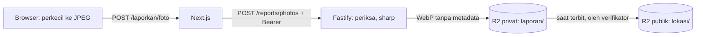

# ADR-0031: Foto Laporan Diproses API dan Disimpan di Bucket R2 Privat sampai Terbit

- Status: Accepted
- Tanggal: 2026-11-07
- Pengambil keputusan: Tim AksesBogor
- Issue: #54
- Melengkapi: [ADR-0023](0023-hingga-sepuluh-foto-bertag-per-laporan.md) (rincian penyimpanan dan pemrosesan)

## Konteks dan Masalah

[ADR-0023](0023-hingga-sepuluh-foto-bertag-per-laporan.md) menetapkan 10 foto bertag per laporan, diperkecil di browser, lalu diperiksa, disandikan ulang, dan dibersihkan dari EXIF oleh Fastify sebelum disimpan ke Cloudflare R2. [ADR-0013](0013-tech-stack-nextjs-fastify.md) melarang browser terhubung langsung ke R2. Yang belum diputuskan: susunan bucket, siapa yang bisa membaca foto yang belum diverifikasi, library untuk memproses foto, dan cara API berbicara dengan R2. Foto yang belum dimoderasi bisa memperlihatkan wajah, pelat nomor, atau bagian dalam toilet ([Panduan Verifikasi](../operations/panduan-verifikasi.md#8-privasi-dan-moderasi-foto)).

## Decision Drivers

- Foto yang belum diverifikasi tidak bisa dibuka publik, walaupun alamatnya bocor.
- Lokasi GPS dan metadata lain di foto tidak pernah tersimpan (UU No. 27 Tahun 2022, PRD bagian 7).
- Server tidak memercayai jenis dan ukuran berkas dari klien.
- Biaya tetap di paket gratis R2, dan Evergarden tidak kehabisan memori.
- Dependensi baru sesedikit dan sekecil mungkin.

## Opsi yang Dipertimbangkan

1. Lewat API, diproses dengan `sharp`, disimpan di bucket privat lalu dipindah ke bucket publik saat terbit
2. Lewat API, langsung disimpan di bucket publik dengan nama acak
3. Unggah langsung dari browser ke R2 dengan URL bertanda tangan, lalu diproses API

## Keputusan

Opsi terpilih: "Bucket privat, dipindah saat terbit".

### Alur unggah

- Browser memperkecil foto: sisi terpanjang maksimal 2048 px, JPEG kualitas 0,8. JPEG dipilih karena Safari belum bisa menyimpan WebP dari canvas.
- Server Next.js meneruskan berkas apa adanya dengan token sesi. Foto baru diunggah saat pelapor menekan "Kirim laporan" ([ADR-0033](0033-isi-dulu-masuk-saat-kirim-dan-draf-di-perangkat.md)).

### Pemeriksaan dan pemrosesan di API

- Jenis berkas dibaca dari byte awalnya, bukan dari header: hanya JPEG, PNG, dan WebP. HEIC tidak diterima API; iPhone mengubahnya ke JPEG saat memilih foto, dan browser yang bisa membaca HEIC mengubahnya saat memperkecil.
- Ukuran maksimal 3 MB, maksimal 40 megapiksel sebelum didekode (mencegah "bom dekompresi"), satu bingkai saja (tanpa animasi), dan berkas harus bisa didekode utuh.
- `sharp` memutar foto sesuai orientasinya, memperkecil bila sisi terpanjang lebih dari 2048 px, mengubah warna ke sRGB, lalu menyimpan WebP kualitas 80. `sharp` tidak menyalin metadata apa pun, jadi EXIF, GPS, XMP, dan profil warna terbuang.
- Lebar, tinggi, dan ukuran hasil disimpan di tabel `photos`.

### Bucket dan akses

| Bucket | Akses | Isi | Kunci berkas |
| --- | --- | --- | --- |
| Foto laporan (baru) | Privat | Foto yang menunggu verifikasi atau ditolak | `laporan/<id foto>.webp` |
| Foto publik (sudah ada, `PHOTO_PUBLIC_URL`) | Publik lewat domain sendiri | Foto yang lolos moderasi | `lokasi/<id lokasi>/<id foto>.webp` |

- Foto yang belum terbit hanya bisa dibaca verifikator dan admin lewat API, diteruskan server web. Pelapor melihat salinan di perangkatnya sendiri selama mengisi formulir.
- Saat laporan diterbitkan, foto yang lolos moderasi disalin ke bucket publik lalu dihapus dari bucket privat. Foto yang disembunyikan tidak pernah disalin. Langkah ini dibangun bersama panel verifikator.
- API berbicara dengan R2 lewat S3 API yang ditandatangani `aws4fetch`. Token R2 cukup "Object Read & Write" untuk dua bucket ini saja.

### Pembersihan

- Foto yang sudah diunggah tetapi tidak jadi dipasang ke laporan dalam 24 jam dihapus beserta berkasnya.
- Tabel `photo_deletions` ([ADR-0024](0024-data-setelah-akun-dihapus.md)) dikosongkan API setiap jam: berkas dihapus dari kedua bucket, lalu barisnya dibuang. Penghapusan yang gagal dicoba lagi jam berikutnya.

### Pengembangan lokal dan konfigurasi

Tanpa konfigurasi R2 di development, foto disimpan di folder lokal (`PHOTO_STORAGE_DIR`). Di production tanpa R2, unggah foto menjawab 503 `foto_belum_diatur`, dan formulir menawarkan kirim laporan tanpa foto.

| Variabel | Rahasia | Isi |
| --- | --- | --- |
| `R2_ACCOUNT_ID` | Tidak | ID akun Cloudflare untuk endpoint R2 |
| `R2_ACCESS_KEY_ID` | Ya | Access key token R2 |
| `R2_SECRET_ACCESS_KEY` | Ya | Secret token R2 |
| `R2_BUCKET_LAPORAN` | Tidak | Nama bucket privat foto laporan |
| `R2_BUCKET_PUBLIK` | Tidak | Nama bucket foto publik |

## Konsekuensi

- Positif: foto yang belum dimoderasi tidak bisa dibuka publik, dan setiap foto yang tersimpan sudah tanpa metadata.
- Positif: R2 tidak memungut biaya keluar data. Paket gratis mencakup 10 GB, 1 juta operasi tulis, dan 10 juta operasi baca per bulan; perkiraan ADR-0023 sekitar 4 GB per 1.000 laporan penuh.
- Negatif: dua dependensi runtime baru. `sharp` (Apache-2.0) membawa libvips (LGPL) siap pakai untuk Linux x64, sekitar 20 MB. `aws4fetch` (MIT) sekitar 10 KB tanpa dependensi.
- Negatif: Evergarden memproses foto. Satu foto 3 MB butuh puluhan MB memori sesaat, jadi `sharp` dibatasi satu proses sekaligus dan cache-nya dimatikan.
- Negatif: setiap foto lewat Vercel dua kali (masuk dan keluar), sehingga terhitung di kuota transfer Vercel. Batas badan permintaan fungsi Vercel 4,5 MB masih di atas batas 3 MB.
- Negatif: penerbitan perlu langkah salin antar-bucket, dan bucket baru beserta tokennya dibuat tim sendiri.

## Pro & Kontra tiap Opsi

### Bucket privat, dipindah saat terbit

- Pro: foto mentah dan foto yang belum dimoderasi tidak pernah publik.
- Kontra: dua bucket dan langkah salin saat terbit.

### Satu bucket publik dengan nama acak

- Pro: paling sederhana; tidak ada salin saat terbit.
- Kontra: foto yang belum dimoderasi bisa dibuka siapa pun yang tahu alamatnya.

### Unggah langsung ke R2 dengan URL bertanda tangan

- Pro: tidak membebani Vercel dan Evergarden saat unggah.
- Kontra: berkas mentah dengan GPS sempat tersimpan di R2, dan bertentangan dengan aturan ADR-0013 bahwa browser tidak terhubung ke R2.

## Referensi

- [ADR-0013](0013-tech-stack-nextjs-fastify.md), [ADR-0023](0023-hingga-sepuluh-foto-bertag-per-laporan.md), [ADR-0024](0024-data-setelah-akun-dihapus.md), [ADR-0029](0029-akun-better-auth-dan-sesi-lewat-server-web.md), [ADR-0033](0033-isi-dulu-masuk-saat-kirim-dan-draf-di-perangkat.md)
- [PRD](../product/prd.md), FR-25 dan kebutuhan non-fungsional Privasi dan keamanan
- [sharp](https://sharp.pixelplumbing.com/), [aws4fetch](https://github.com/mhart/aws4fetch)
- [Harga Cloudflare R2](https://developers.cloudflare.com/r2/pricing/)
