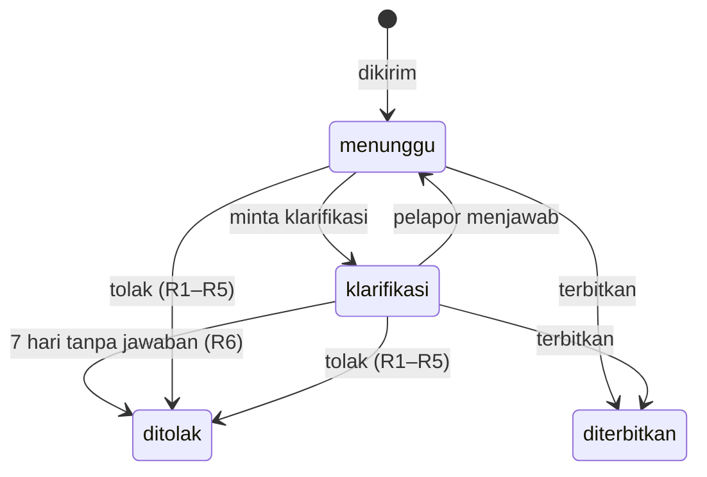

# ADR-0036: Keputusan Verifikasi per Jawaban, dan Klarifikasi Dijawab di Laporan Saya

- Status: Accepted
- Tanggal: 2026-11-08
- Pengambil keputusan: Tim AksesBogor
- Issue: #58
- Melengkapi: [ADR-0019](0019-verifikasi-tim-dan-mitra-terlatih.md), [ADR-0033](0033-isi-dulu-masuk-saat-kirim-dan-draf-di-perangkat.md)

## Konteks dan Masalah

[ADR-0019](0019-verifikasi-tim-dan-mitra-terlatih.md) menetapkan tiga hasil verifikasi: terbitkan, minta klarifikasi dengan batas 7 hari, atau tolak dengan alasan baku. Yang belum diputuskan: bagaimana verifikator memeriksa setiap jawaban, bagaimana laporan perubahan dan kekurangan mengubah lokasi yang sudah tayang tanpa membuat lokasi ganda (FR-27), bagaimana pelapor menjawab klarifikasi, dan bagaimana batas 7 hari dijalankan.

## Decision Drivers

- Hanya jawaban yang punya bukti yang tayang; status dihitung, tidak dipilih ([ADR-0018](0018-status-pintu-masuk-dulu-dan-ringkasan-fasilitas.md)).
- Data lama tetap tayang sampai perubahan diterbitkan, dan perubahan tidak membuat lokasi kedua.
- Klarifikasi lewat sistem, tidak lewat kontak pribadi (ADR-0019), dan pelapor bisa menambah foto karena kebanyakan klarifikasi meminta foto.
- Tidak ada server, timer, atau dependensi baru.

## Opsi yang Dipertimbangkan

1. Jawaban klarifikasi berupa teks dan foto di Laporan saya, batas 7 hari dijalankan tugas berkala di dalam API
2. Jawaban teks saja
3. Pelapor membuka ulang seluruh formulir
4. Pelapor membalas email

## Keputusan

Opsi terpilih: "Teks dan foto di Laporan saya, tugas berkala di API".

### Status laporan

- Antrean memuat laporan `menunggu`, terlama dulu menurut waktu kirim. Laporan yang kembali dari klarifikasi tetap di posisi aslinya dan ditandai "dijawab".
- Laporan `klarifikasi` tampil di tab terpisah dengan tenggatnya. Verifikator masih bisa menerbitkan atau menolaknya, mis. setelah pengelola tempat menjawab lewat telepon.
- Diterbitkan dan ditolak adalah keadaan akhir.

### Memeriksa setiap jawaban (FR-33)

- Untuk setiap fasilitas, verifikator melihat jawaban pelapor, data saat ini (untuk perubahan dan kekurangan), lalu menetapkan jawaban akhir beserta alasan dan catatannya.
- Setiap jawaban akhir ditandai **Terbukti** atau **Tanpa bukti**. Tanpa bukti membuat jawabannya Belum tahu, apa pun isinya ([ADR-0019](0019-verifikasi-tim-dan-mitra-terlatih.md)).
- Terbitkan baru bisa ditekan setelah keempat fasilitas ditandai, dan setiap Tidak tersedia punya alasan ([ADR-0022](0022-tersedia-berarti-bisa-dipakai.md)). API memeriksa hal yang sama.
- Halaman pemeriksaan menampilkan pratinjau status dari jawaban akhir. Status yang tersimpan tetap dihitung API saat terbit.

### Menerbitkan laporan

| Jenis | Yang diambil dari keputusan verifikator |
| --- | --- |
| Baru | Lokasi baru: nama, kategori, titik, patokan, deskripsi, dan keempat jawaban |
| Perubahan (Edit lokasi) | Lokasi yang sama diperbarui: nama, kategori, titik, patokan, deskripsi, dan keempat jawaban |
| Kekurangan | Lokasi yang sama diperbarui: deskripsi dan keempat jawaban; nama, kategori, titik, dan patokan tetap |

- Verifikator boleh memperbaiki isian sebelum terbit: ejaan nama, kategori, pin (dengan pemilih lokasi Laporkan), dan menghapus data pribadi dari patokan, catatan, atau deskripsi ([Panduan Verifikasi](../operations/panduan-verifikasi.md), bagian 4 dan 8).
- Kecamatan dihitung ulang dari titik akhir. Titik di luar Kota Bogor tidak bisa diterbitkan; laporannya ditolak dengan R1.
- Formulir perubahan dan kekurangan sudah terisi data saat ini ([ADR-0033](0033-isi-dulu-masuk-saat-kirim-dan-draf-di-perangkat.md)), jadi keempat jawaban akhir menggantikan jawaban lokasi. Jawaban yang tidak diubah pelapor tetap sama.
- Foto yang lolos moderasi ditambahkan ke foto lokasi; foto lama tetap ([ADR-0037](0037-foto-dikaburkan-di-api-dan-asli-dihapus.md)).
- Tanggal verifikasi terakhir lokasi menjadi waktu terbit.
- Halaman pemeriksaan membawa versi data lokasi saat dibuka. Bila lokasi berubah sebelum terbit (mis. laporan lain baru diterbitkan), API menjawab 409 `lokasi_berubah` dan verifikator memeriksa ulang dengan data terbaru.

### Menolak

- Alasan R1 sampai R5 dari [Panduan Verifikasi](../operations/panduan-verifikasi.md#63-tolak-dengan-alasan-baku). R6 hanya dipakai sistem.
- Pelapor hanya menerima pesan baku alasan itu, tanpa teks bebas dari verifikator.
- Foto laporan yang ditolak langsung dihapus ([ADR-0037](0037-foto-dikaburkan-di-api-dan-asli-dihapus.md)). Isian laporan tetap ada supaya Laporan saya bisa menunjukkan alasannya, sampai akun dihapus ([ADR-0024](0024-data-setelah-akun-dihapus.md)).

### Catatan verifikator

- Setiap keputusan boleh disertai catatan internal, maksimal 1.000 karakter, mis. "Ramp terlihat di foto 2". Catatan hanya dilihat verifikator dan admin, tidak pernah dikirim ke pelapor atau tayang.

### Klarifikasi

- Verifikator menulis satu pertanyaan, maksimal 1.000 karakter. Pelapor mendapat email ([ADR-0039](0039-email-status-laporan.md)) dengan tautan ke halaman jawab di Laporan saya.
- Pelapor menjawab satu kali per pertanyaan: teks maksimal 1.000 karakter dan foto baru bertag, selama jumlah foto laporan tidak lebih dari 10 ([ADR-0023](0023-hingga-sepuluh-foto-bertag-per-laporan.md)). Foto diperkecil di browser dan diproses API seperti foto laporan ([ADR-0031](0031-foto-laporan-di-bucket-r2-privat.md)).
- Setelah dijawab, laporan kembali `menunggu`. Verifikator boleh bertanya lagi; setiap pertanyaan punya batas 7 hari sendiri. Pertanyaan dan jawaban tersimpan berurutan dan tampil di halaman pemeriksaan.
- Jawaban klarifikasi adalah bagian laporan: hanya dilihat verifikator dan admin, ikut terhapus bersama laporan yang belum terbit saat akun dihapus, dan ikut tersimpan tanpa nama pada laporan yang sudah terbit.

### Batas 7 hari

- Tenggat adalah 7 × 24 jam sejak pertanyaan dikirim, dan tampil di email serta Laporan saya.
- API menjalankan pemeriksaan tenggat saat server mulai lalu setiap jam, seperti pembersihan akun dan foto. Laporan yang lewat tenggat menjadi ditolak dengan R6, fotonya dihapus, dan pelapor mendapat email. Penolakan bisa terlambat paling lama sekitar satu jam.
- Tidak ada unit systemd baru dan tidak ada langkah `sudo` untuk memasangnya.

## Konsekuensi

- Positif: jawaban tanpa bukti tidak pernah tayang sebagai Tersedia atau Tidak perlu, tanpa harus menolak seluruh laporan.
- Positif: perubahan dan kekurangan memperbarui lokasi yang sama, dan data lama tetap tayang sampai terbit.
- Positif: pelapor bisa melengkapi foto tanpa mengisi ulang formulir.
- Negatif: halaman pemeriksaan butuh empat keputusan per laporan, ditambah alasan untuk setiap Tidak tersedia.
- Negatif: jawaban klarifikasi menambah satu halaman dan unggah foto di sisi pelapor.
- Negatif: tugas berkala hanya berjalan selama API hidup. Bila API mati lebih lama, penolakan R6 menyusul saat API hidup lagi.
- Negatif: foto lama lokasi tetap tayang setelah perubahan, walaupun mungkin sudah tidak sesuai. Menyembunyikan foto lokasi lama belum termasuk.

## Pro & Kontra tiap Opsi

### Teks dan foto di Laporan saya

- Pro: sesuai contoh klarifikasi di Panduan, yang kebanyakan meminta foto.
- Kontra: halaman dan alur unggah baru di sisi pelapor.

### Teks saja

- Pro: paling sedikit kerja.
- Kontra: klarifikasi yang meminta foto berakhir ditolak R3.

### Membuka ulang seluruh formulir

- Pro: pelapor bisa mengubah apa saja.
- Kontra: foto yang sudah diunggah tidak bisa dimuat kembali ke draf; verifikator harus memeriksa ulang semuanya.

### Balas email

- Pro: pelapor tidak perlu membuka situs.
- Kontra: butuh layanan email masuk, alamat pelapor ikut ke alur verifikasi, dan lampiran foto tidak lewat pemeriksaan API.

## Referensi

- [ADR-0017](0017-empat-jawaban-ketersediaan-fasilitas.md), [ADR-0018](0018-status-pintu-masuk-dulu-dan-ringkasan-fasilitas.md), [ADR-0019](0019-verifikasi-tim-dan-mitra-terlatih.md), [ADR-0022](0022-tersedia-berarti-bisa-dipakai.md), [ADR-0023](0023-hingga-sepuluh-foto-bertag-per-laporan.md), [ADR-0024](0024-data-setelah-akun-dihapus.md), [ADR-0031](0031-foto-laporan-di-bucket-r2-privat.md), [ADR-0033](0033-isi-dulu-masuk-saat-kirim-dan-draf-di-perangkat.md)
- [PRD](../product/prd.md), FR-27, FR-30 sampai FR-33
- [Panduan Verifikasi](../operations/panduan-verifikasi.md), bagian 4, 6, dan 7
