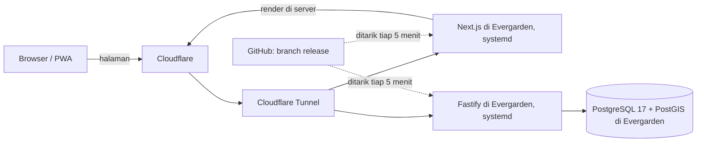

# ADR-0048: Web Di-host Sendiri di Evergarden OCI

- Status: Accepted
- Tanggal: 2026-11-22
- Pengambil keputusan: Tim AksesBogor
- Issue: #95
- Men-supersede sebagian: [ADR-0013](0013-tech-stack-nextjs-fastify.md) (web di Vercel), [ADR-0026](0026-api-dan-postgresql-di-evergarden-oci.md) (web tetap di Vercel dan Vercel membangun `release`), [ADR-0045](0045-alamat-staging-di-aldio-dev.md) (web sebagai custom domain Vercel dan alias `akses-bogor.vercel.app`)

## Konteks dan Masalah

Pada 2026-11-22 Vercel menangguhkan tim "Evergarden" karena tagihan. Sejak itu `https://akses-bogor.aldio.dev` dan alias `akses-bogor.vercel.app` menjawab 402 `DEPLOYMENT_DISABLED`, dan tidak ada yang bisa di-deploy. Domain produksi akhir juga sudah diputuskan tidak memakai Vercel ([ADR-0045](0045-alamat-staging-di-aldio-dev.md)). API dan PostgreSQL sudah berjalan di Evergarden dan di-deploy dari branch `release` oleh timer ([ADR-0026](0026-api-dan-postgresql-di-evergarden-oci.md)). Di mana web Next.js berjalan sekarang, bagaimana deploy dan rollback-nya, dan apa yang hilang dibanding Vercel?

## Decision Drivers

- Staging harus bisa dibuka lagi secepatnya, tanpa akun berbayar baru.
- Alur rilis tetap sama dengan API: merge `main` ke `release` berarti rilis, tanpa SSH dari luar atau secret di GitHub.
- Evergarden dipakai bersama layanan lain dan tidak punya swap, jadi memori build dan runtime harus dibatasi.
- Build tanpa pengawasan harus memberi hasil yang sama setiap kali, siapa pun yang memicunya.
- Web di belakang Cloudflare tidak boleh membuka celah baru, misalnya IP pengunjung yang bisa dipalsukan.

## Opsi yang Dipertimbangkan

1. Evergarden: systemd + `next start` dengan `node_modules` lengkap, di-deploy timer dari `release`
2. Evergarden: `output: "standalone"`
3. Evergarden: container Docker
4. Platform hosting lain, misalnya Cloudflare Workers lewat OpenNext atau Netlify
5. Membayar Vercel lagi

## Keputusan

Opsi terpilih: "Evergarden: systemd + `next start`", karena server, tunnel, dan pola deploy-nya sudah berjalan untuk API, dan build yang di-deploy sama persis dengan yang diuji CI (`pnpm build` lalu `pnpm start`).

| Lapisan | Pilihan |
| --- | --- |
| Server | Evergarden, VM yang sama dengan API dan PostgreSQL ([ADR-0026](0026-api-dan-postgresql-di-evergarden-oci.md)) |
| Web | Service systemd `akses-bogor-web` dengan user sistem `aksesbogor-web`: `next start` di `127.0.0.1:8091`, Node.js 24, memori dibatasi 1 GB. Setelah semua halaman dibuka, pemakaiannya sekitar 260 MB. User ini tidak punya akses database dan tidak bisa membaca `api.env` |
| Konfigurasi | `/etc/akses-bogor/web.env`, milik `root:aksesbogor-web` dengan mode `0640`. User web hanya diberi hak masuk ke folder `/etc/akses-bogor` lewat ACL. Contohnya `deploy/web.env.example` di akses-bogor-web |
| Deploy | Timer systemd memeriksa `release` setiap 5 menit. Skrip deploy mengekspor commit ke folder rilis baru, menjalankan `pnpm install --frozen-lockfile` dan `pnpm build`, memindahkan tautan `current`, me-restart web, lalu memeriksa `/` dan `/robots.txt`. Tiga rilis terakhir disimpan |
| Isi `web.env` saat build | `NEXT_PUBLIC_*`, `SITE_URL`, dan `SITE_INDEXABLE` ditanam saat build, jadi `web.env` dibaca saat build dan saat runtime. Nama folder rilis memuat hash `web.env`, sehingga mengubah `web.env` membuat timer membangun rilis baru dari commit yang sama. Build ditolak bila `API_URL` atau `SITE_URL` kosong |
| Rollback otomatis | Bila health check gagal setelah restart, `current` dikembalikan ke rilis sebelumnya dan web di-restart lagi. Rilis yang gagal ditandai dan tidak dicoba lagi sampai `release` atau `web.env` berubah. Unit deploy berstatus gagal, dan rinciannya ada di journal |
| Rollback manual | Seperti API: hentikan timer, pindahkan `current` ke rilis lama, restart, lalu revert di `release` |
| Akses dari luar | Public hostname `akses-bogor.aldio.dev` di Cloudflare Tunnel Evergarden yang sama, diarahkan ke `http://127.0.0.1:8091`. Cloudflare mem-proxy situs, dan port web tidak dibuka ke internet |
| IP pengunjung | Dibaca dari `cf-connecting-ip`, yang selalu ditulis Cloudflare, seperti di API. `x-forwarded-for` hanya dipakai bila header itu tidak ada (lokal dan tes) |
| Sumber daya build | Sekitar 20 detik dan puncak memori sekitar 2 GB (diukur dari cgroup unit deploy, termasuk page cache). Unit deploy dibatasi 4 GB dan diberi bobot CPU rendah, supaya API dan layanan lain tetap didahulukan |

### `next start`, bukan `output: "standalone"`

Standalone menghasilkan folder yang lebih kecil tanpa devDependencies, tetapi butuh perubahan `next.config.ts`, penyalinan `public/` dan `.next/static` dengan tangan, dan cara menjalankan yang berbeda dari CI dan tes lokal. Dengan `next start`, yang di-deploy adalah hasil build yang sama dengan yang diuji Playwright. `node_modules` lengkap tidak memakan banyak disk, karena pnpm membuat hard link dari store di disk yang sama: store sekitar 660 MB sekali saja, dan setiap rilis hampir seluruhnya berupa tautan. Ukuran folder baru penting bila web dikirim sebagai image, dan itu tidak terjadi di sini.

### Build yang Sama Setiap Kali

Sebelumnya `next build` kadang berhenti sekali dengan `SecurityFatalError` lalu berhasil saat diulang. Penyebabnya fitur pengingat upgrade di Next.js 16.4 (`experimental.agentUpgrade`, bawaannya `security`):

- Pengingat hanya muncul bila Next.js mendeteksi coding agent dari environment, misalnya `CLAUDECODE` atau `AI_AGENT`. Next.js lalu memeriksa advisory npm, dan bila versinya terkena, build dihentikan dengan exit 1 setelah semua halaman selesai dibuat.
- Next.js juga menulis tanda di `.next/cache/next-agentic-upgrade-retries` yang berlaku 5 menit, jadi build ulang dalam waktu itu lolos. Itulah sebabnya pengulangan selalu berhasil.
- Tanpa agent, tanpa terminal, dan dengan `CI=true`, seperti di systemd, pengingat ini tidak pernah berjalan, dan advisory tidak diperiksa.

Skrip deploy menjalankan build dengan environment kosong yang hanya berisi `web.env` dan beberapa variabel dasar, sehingga hasil build tidak bergantung pada siapa yang menjalankannya. Tidak ada pengulangan otomatis.

Advisory-nya sendiri nyata: Next.js 16.4.2 terkena tujuh advisory tingkat *moderate* yang diperbaiki di 16.4.5, termasuk [GHSA-pc58-hwjq-p385](https://github.com/advisories/GHSA-pc58-hwjq-p385) yang khusus aplikasi self-hosted. Upgrade ke 16.4.5 dikerjakan di PR tersendiri di akses-bogor-web.

Build masih butuh jaringan: paket baru dari registry npm (yang sudah ada diambil dari store pnpm) dan font dari Google Fonts lewat `next/font/google`. Bila salah satunya tidak bisa dihubungi, build gagal, `current` tidak berpindah, dan timer mencobanya lagi lima menit kemudian, sama seperti build API yang gagal.

## Konsekuensi

- Positif: staging bisa dibuka lagi tanpa biaya hosting baru, dan domain produksi nanti tidak terikat ke Vercel.
- Positif: web dan API memakai alur rilis, log (`journalctl`), dan cara rollback yang sama. Rollback otomatis ini belum ada di API.
- Positif: halaman dirender di Batam, dekat dengan API dan pengguna di Bogor, dan log server web tetap di Indonesia.
- Positif: sesi yang sudah ada tetap berlaku, karena cookie sesi terikat ke `akses-bogor.aldio.dev` ([ADR-0029](0029-akun-better-auth-dan-sesi-lewat-server-web.md)), bukan ke penyedia hosting.
- Negatif: tidak ada lagi preview deployment per PR. Screenshot di PR diambil dari Playwright di lokal, dan tim memeriksa staging setelah rilis.
- Negatif: CDN dan edge Vercel hilang. Cloudflare tetap mem-proxy situs dan bisa menyimpan berkas statis `/_next/static` di edge sesuai header cache-nya, tetapi HTML selalu dirender di Evergarden.
- Negatif: Instant Rollback dan log build di dashboard Vercel diganti tautan `current` dan journal. Belum ada notifikasi bila deploy gagal, sama seperti API.
- Negatif: web, API, dan database sekarang bergantung pada satu server. Bila Evergarden mati, situs tidak bisa dibuka sama sekali, bukan hanya datanya yang hilang.
- Negatif: setiap rilis memakai sekitar 2 GB memori selama sekitar 20 detik di server yang sudah sempit. Batas memori unit deploy membuat build yang membengkak gagal sendiri tanpa mengganggu layanan lain.
- Negatif: Node.js, pembaruan sistem operasi, dan keamanan server web sekarang diurus tim, termasuk pembaruan Next.js saat ada advisory baru.
- Netral: `akses-bogor.vercel.app` tidak bisa dibuka lagi. Tautan lama ke alamat itu putus, dan alamat itu boleh dihapus dari `FRONTEND_ORIGINS` di API dan dari origin klien OAuth Google.
- Netral: Kebijakan Privasi masih menyebut Vercel sebagai penyedia yang menjalankan situs web. Perubahan itu butuh versi kebijakan baru, dan dikerjakan terpisah.
- Netral: web memanggil API lewat alamat publiknya (`API_URL=https://akses-bogor-api.aldio.dev`), jadi lewat Cloudflare walaupun keduanya di server yang sama. Memanggil `http://127.0.0.1:8090` langsung lebih cepat, tetapi tanpa `WEB_SERVER_SECRET` semua pengunjung akan berbagi kunci rate limit `127.0.0.1`. Bisa dipertimbangkan setelah rahasia itu terpasang.

## Pro & Kontra tiap Opsi

### Evergarden: systemd + `next start`

- Pro: pola yang sama dengan API, tunnel sudah ada, dan yang di-deploy sama dengan yang diuji CI.
- Kontra: devDependencies ikut terpasang di server; build memakai memori di server yang dipakai bersama.

### Evergarden: `output: "standalone"`

- Pro: folder rilis kecil dan tanpa devDependencies.
- Kontra: mengubah `next.config.ts`, butuh langkah salin tambahan, dan cara menjalankannya berbeda dari CI. Build tetap berjalan di server.

### Evergarden: container Docker

- Pro: lingkungan bisa dibuat ulang dari berkas di repo.
- Kontra: user deploy tidak punya akses Docker (alasan yang sama di ADR-0026), dan image perlu dibangun dan disimpan di suatu tempat.

### Platform hosting lain

- Pro: CDN dan preview per PR tetap ada.
- Kontra: akun dan tagihan baru, dan cara kerjanya berbeda dari Vercel. Cloudflare Workers butuh adapter OpenNext, yang belum tentu mendukung Cache Components dan `next/og` di Next.js 16. Data render juga keluar dari Indonesia.

### Membayar Vercel lagi

- Pro: tidak ada yang perlu diubah.
- Kontra: biaya bulanan, dan domain produksi akhir tetap harus pindah dari Vercel.

## Referensi

- [ADR-0013](0013-tech-stack-nextjs-fastify.md), [ADR-0026](0026-api-dan-postgresql-di-evergarden-oci.md), [ADR-0045](0045-alamat-staging-di-aldio-dev.md) (di-supersede sebagian)
- [ADR-0029](0029-akun-better-auth-dan-sesi-lewat-server-web.md) (sesi lewat server web)
- Issue #95; berkas deploy di [akses-bogor-web](https://github.com/al-dioooo/akses-bogor-web) folder `deploy/` dan README bagian Deployment
- Advisory Next.js 16.4.2: [GHSA-pc58-hwjq-p385](https://github.com/advisories/GHSA-pc58-hwjq-p385), [GHSA-vvgp-ww4w-46vf](https://github.com/advisories/GHSA-vvgp-ww4w-46vf), [GHSA-rhh4-g77r-r9qj](https://github.com/advisories/GHSA-rhh4-g77r-r9qj), [GHSA-mfr8-8qww-v76h](https://github.com/advisories/GHSA-mfr8-8qww-v76h), [GHSA-vc7v-qv4w-wrv8](https://github.com/advisories/GHSA-vc7v-qv4w-wrv8), [GHSA-7qx7-33qx-rqx2](https://github.com/advisories/GHSA-7qx7-33qx-rqx2), [GHSA-f3mh-rxg3-f5g2](https://github.com/advisories/GHSA-f3mh-rxg3-f5g2)
