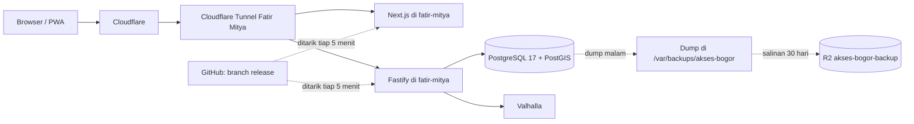

# ADR-0059: Produksi Pindah ke Server Tim di Karawang

- Status: Accepted
- Tanggal: 2026-11-27
- Pengambil keputusan: Tim AksesBogor
- Issue: #155
- Men-supersede sebagian: [ADR-0026](0026-api-dan-postgresql-di-evergarden-oci.md) (server produksi API dan PostgreSQL di Evergarden, dan tunnel Evergarden), [ADR-0048](0048-web-di-host-sendiri-di-evergarden-oci.md) (server web di Evergarden, dan izin folder konfigurasi lewat ACL)

## Konteks dan Masalah

Sejak [ADR-0026](0026-api-dan-postgresql-di-evergarden-oci.md) dan [ADR-0048](0048-web-di-host-sendiri-di-evergarden-oci.md), API, web, PostgreSQL, dan cadangan malam AksesBogor berjalan di Evergarden, VM Oracle Cloud Infrastructure (OCI) di region Batam. Pada 2026-11-26 tim berhenti memakai OCI untuk produksi. Tim punya server sendiri di Karawang, Jawa Barat (host fatir-mitya). Ke mana produksi pindah, apa yang sama dan apa yang berubah dibanding Evergarden, dan apa akibatnya bagi data pribadi pengguna?

Keputusan ini dicatat sehari setelah pemindahan, setelah Kebijakan Privasi versi 2026-11-27 menyebut server baru dan [pemeriksaan UU PDP 2026-11-27](../product/pemeriksaan-uu-pdp-2026-11-27.md) mencatat bahwa ADR-nya belum ada.

## Decision Drivers

- Produksi harus berjalan lagi secepatnya, tanpa akun atau tagihan baru.
- Data tetap di Indonesia (UU No. 27 Tahun 2022), dan sebaiknya tanpa penyedia server baru yang ikut memproses data pribadi.
- Alur rilis tetap sama: merge `main` ke `release` berarti rilis, tanpa SSH dari luar atau secret di GitHub.
- Berkas deploy di akses-bogor-api dan akses-bogor-web tetap bisa dipakai tanpa diubah.
- Tidak ada port yang dibuka ke internet, seperti di Evergarden.

## Opsi yang Dipertimbangkan

1. Server milik tim di Karawang (fatir-mitya), dengan tata letak yang sama dengan Evergarden
2. VM di penyedia cloud lain dengan region Indonesia
3. Tetap di Evergarden

## Keputusan

Opsi terpilih: "Server milik tim di Karawang", karena server itu sudah ada dan dikelola tim, berada di Indonesia, tidak menambah penyedia yang memproses data pribadi, dan bisa memakai unit systemd, skrip deploy, dan path yang sama dengan Evergarden.

| Lapisan | Pilihan |
| --- | --- |
| Server | fatir-mitya, milik tim, di Karawang, Jawa Barat. Server ini kecil: sekitar 3,8 GB RAM dengan CPU lama ([ADR-0055](0055-rute-pejalan-kaki-aksesibel-dengan-valhalla.md)), dipakai bersama oleh API, web, PostgreSQL, dan Valhalla |
| API, web, database | Unit systemd, user sistem, dan path yang sama dengan Evergarden: `akses-bogor-api` (user `aksesbogor`, rilis di `/srv/akses-bogor`), `akses-bogor-web` (user `aksesbogor-web`, rilis di `/srv/akses-bogor-web`), konfigurasi di `/etc/akses-bogor`, dan PostgreSQL 17 + PostGIS dengan autentikasi peer. Port PostgreSQL di fatir-mitya belum dicatat di docs; periksa dengan `pg_lsclusters` |
| Rute OpenStreetMap | Valhalla dan timer ubin mingguan dari `deploy/valhalla/` di akses-bogor-api ([ADR-0055](0055-rute-pejalan-kaki-aksesibel-dengan-valhalla.md)) |
| Deploy | `akses-bogor-deploy.timer` (API) dan `akses-bogor-web-deploy.timer` (web) di fatir-mitya memeriksa `release` setiap 5 menit, dengan skrip yang sama. Timer dan service yang sama di Evergarden dimatikan (`disabled`, `inactive` saat diperiksa 2026-11-27), supaya `release` tidak di-deploy ke dua server |
| Akses dari luar | Cloudflare Tunnel `9a1227b2…` ("Fatir Mitya"), dikelola dari dashboard Cloudflare Zero Trust. Public hostname `akses-bogor.aldio.dev` dan `akses-bogor-api.aldio.dev` dipindah dari tunnel Evergarden ke tunnel ini. Tunnel Evergarden tidak lagi memuat hostname AksesBogor (diperiksa 2026-11-27), dan hostname lain di tunnel itu tidak berubah |
| Cadangan | `akses-bogor-backup.timer` pukul 02.30 WIB: tujuh dump terakhir di `/var/backups/akses-bogor`, dan sejak 2026-11-27 salinannya di bucket R2 privat `akses-bogor-backup` (lokasi APAC, dihapus setelah 30 hari). Rinciannya di [runbook cadangan](../operations/cadangan-database.md) |

### Izin yang Perlu Diperbaiki

Dua hal yang berjalan di Evergarden tidak langsung berjalan di fatir-mitya:

- **HOME user layanan.** Unit deploy memakai `ProtectHome=true` dan hanya boleh menulis di `/srv/akses-bogor` atau `/srv/akses-bogor-web` (`ReadWritePaths`), sedangkan corepack dan pnpm menyimpan cache di `$HOME`. Di Evergarden, HOME user layanan memang di `/srv` (`useradd --home-dir /srv/akses-bogor`, README akses-bogor-api). Di fatir-mitya HOME itu diarahkan ke folder di bawah `/srv` lewat drop-in systemd (`Environment=HOME=…` di `/etc/systemd/system/<unit>.d/`). Drop-in ini dipasang dengan tangan dan belum ada di folder `deploy/` kedua repo.
- **Folder `/etc/akses-bogor`.** User `aksesbogor-web` harus bisa masuk ke folder ini untuk membaca `web.env` saat build dan runtime, tetapi tidak boleh membaca `api.env`. Di Evergarden ini diatur dengan ACL `u:aksesbogor-web:x` ([ADR-0048](0048-web-di-host-sendiri-di-evergarden-oci.md)). Di fatir-mitya folder itu diberi mode `751`: user lain bisa masuk ke folder bila tahu nama berkasnya, tetapi tidak bisa melihat isinya. Perlindungan berkas sekarang sepenuhnya bergantung pada mode tiap berkas: `api.env` `0640 root:aksesbogor`, `web.env` `0640 root:aksesbogor-web`, dan `backup.env` `0600 root:root`.

## Konsekuensi

- Positif: Oracle tidak lagi menjadi prosesor data pribadi AksesBogor untuk layanan yang berjalan. Situs web, API, database, log server, dan rute OpenStreetMap berjalan di server milik tim di Indonesia. Penyedia yang tersisa adalah Cloudflare (proxy, tunnel, R2), Resend, Mapbox, Anthropic, dan Google untuk Masuk dengan Google, seperti di Kebijakan Privasi versi 2026-11-27.
- Positif: tidak ada akun atau tagihan hosting baru, dan alur rilis, log (`journalctl`), serta cara rollback tetap sama dengan [ADR-0026](0026-api-dan-postgresql-di-evergarden-oci.md) dan [ADR-0048](0048-web-di-host-sendiri-di-evergarden-oci.md).
- Positif: pengunjung tidak melihat perubahan. Alamat situs dan API tetap, dan sesi tetap berlaku karena cookie terikat ke `akses-bogor.aldio.dev` ([ADR-0029](0029-akun-better-auth-dan-sesi-lewat-server-web.md)).
- Negatif: listrik, jaringan, perangkat keras, dan keamanan fisik server menjadi tanggung jawab tim, bukan pusat data penyedia cloud. Bila server atau koneksinya mati, situs tidak bisa dibuka sama sekali.
- Negatif: server lebih kecil dari Evergarden (sekitar 3,8 GB RAM dibanding 16 GB). Build web sekitar 2 GB ([ADR-0048](0048-web-di-host-sendiri-di-evergarden-oci.md)) dan pemotongan ekstrak Valhalla sekitar 2 GB ([ADR-0055](0055-rute-pejalan-kaki-aksesibel-dengan-valhalla.md)) bisa gagal bila berjalan bersamaan atau saat memori sedang terpakai. Keduanya gagal tanpa mengganti versi aktif.
- Negatif: drop-in HOME dan mode `751` dipasang dengan tangan dan belum tercatat di README atau folder `deploy/` akses-bogor-api dan akses-bogor-web. Server yang dibangun ulang dari README saja akan gagal deploy lagi.
- Negatif: mode `751` lebih longgar dari ACL di Evergarden. Setiap user lokal bisa masuk ke `/etc/akses-bogor`. Selama mode berkas di atas benar, isinya tetap tidak terbaca, tetapi berkas baru di folder itu harus dibuat dengan mode yang ketat sejak awal.
- Negatif: cluster PostgreSQL `17/main` (port 5433) di Evergarden masih menyala saat diperiksa 2026-11-27, dan dump di `/var/backups/akses-bogor` di sana belum diperiksa. Selama database dan dump lama itu belum dihapus, salinan data pribadi per 2026-11-26 masih ada di server OCI, sedangkan Kebijakan Privasi versi 2026-11-27 tidak lagi menyebut Oracle.
- Netral: runner GitHub Actions untuk CI akses-bogor-web tetap di Evergarden. Runner itu hanya menjalankan tes dengan data contoh dan tidak memegang data produksi.
- Netral: README akses-bogor-api dan akses-bogor-web bagian Deployment masih menyebut Evergarden dan tunnel Evergarden. Perlu diperbarui di PR tersendiri di kedua repo.

### Tindakan yang Tersisa

- [ ] Setelah cadangan malam di fatir-mitya dan salinan R2 terbukti berjalan beberapa hari, hapus database `aksesbogor` dan dump lama di Evergarden, lalu matikan cluster `17/main` di sana bila tidak dipakai layanan lain. Catat tanggalnya di ADR ini.
- [ ] Catat drop-in HOME dan mode `/etc/akses-bogor` di README Deployment akses-bogor-api dan akses-bogor-web, atau jadikan berkas di `deploy/`.
- [ ] Pastikan journald di fatir-mitya menyimpan log paling lama 30 hari (butir "Sebelum Rilis" di [Kebijakan Privasi](../product/kebijakan-privasi.md)).
- [ ] Catat port PostgreSQL di fatir-mitya di README akses-bogor-api dan runbook yang masih memakai `-p 5433`.

## Pro & Kontra tiap Opsi

### Server milik tim di Karawang

- Pro: sudah ada, tanpa biaya bulanan, di Indonesia, dan tidak ada penyedia server yang ikut memproses data pribadi.
- Pro: berkas deploy dan path yang sama bisa dipakai, jadi pemindahan selesai dalam sehari.
- Kontra: ketersediaan bergantung pada listrik dan jaringan di satu lokasi, dan sumber dayanya kecil.

### VM di penyedia cloud lain dengan region Indonesia

- Pro: pusat data dengan listrik dan jaringan cadangan, dan ukuran VM bisa dipilih.
- Kontra: akun, tagihan, dan prosesor data pribadi baru yang harus masuk ke Kebijakan Privasi dan disetujui ulang pengguna.

### Tetap di Evergarden

- Pro: tidak ada yang perlu dipindah.
- Kontra: tim berhenti memakai OCI untuk produksi pada 2026-11-26, jadi opsi ini tidak tersedia.

## Referensi

- [ADR-0025](0025-api-dan-postgresql-di-vps-sendiri.md) (cadangan malam dan uji pemulihan), [ADR-0026](0026-api-dan-postgresql-di-evergarden-oci.md), [ADR-0048](0048-web-di-host-sendiri-di-evergarden-oci.md) (di-supersede sebagian), [ADR-0055](0055-rute-pejalan-kaki-aksesibel-dengan-valhalla.md) (Valhalla)
- [Runbook cadangan database](../operations/cadangan-database.md), [runbook verifikasi Street View](../operations/verifikasi-street-view.md) (tata letak fatir-mitya)
- [Kebijakan Privasi](../product/kebijakan-privasi.md) versi 2026-11-27 dan [pemeriksaan UU PDP 2026-11-27](../product/pemeriksaan-uu-pdp-2026-11-27.md) (temuan K2 dan K11)
- Issue #155; berkas deploy di folder `deploy/` [akses-bogor-api](https://github.com/al-dioooo/akses-bogor-api) dan [akses-bogor-web](https://github.com/al-dioooo/akses-bogor-web)
